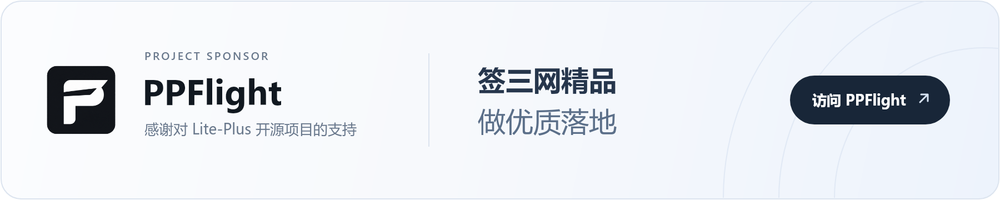

[](https://github.com/nuomiiiii/Lite-Plus/releases)
[](https://github.com/nuomiiiii/Lite-Plus/pkgs/container/lite-plus)
[](https://t.me/komari_lite)
[](LICENSE)

**Lite-Plus** 是从 [Lite](https://github.com/nuomiiiii/Lite) 独立出来的自托管监控与节点管理面板。服务端提供 Web 后台，配套 [Lite-Plus-agent](https://github.com/nuomiiiii/Lite-Plus-agent) 采集节点状态、探测延迟和回程线路；管理员授权后可远程终端、管文件、跑任务。在此之上，Lite-Plus 还管节点上的入站 / 出站 / 路由 / 用户 / 订阅，以及主机入站防火墙。

**当前正式版：Lite-Plus [`0.1.5`](https://github.com/nuomiiiii/Lite-Plus/releases/tag/0.1.5) · 配套 Agent [`0.0.3.1`](https://github.com/nuomiiiii/Lite-Plus-agent/releases/tag/0.0.3.1) · 默认主题 [`1.2.9`](https://github.com/nuomiiiii/Lite-theme/releases/tag/v1.2.9)**

[使用手册](https://nuomiiiii.github.io/Lite-document/) · [快速开始](#快速开始) · [功能概览](#功能概览) · [从 Lite 升级](#从-lite-升级) · [Agent](#agent-与远程管理) · [更新日志](https://github.com/nuomiiiii/Lite-Plus/releases)

> [!WARNING]
> Lite-Plus 只能部署在你拥有或已获得授权管理的设备上。请勿将其用于未经授权的访问、持久化、命令执行或其他滥用行为。管理员应启用 HTTPS 与双因素认证，并妥善保护 Agent Token 和备份文件。

## 赞助商

<a href="https://www.ppflight.com/?aff=1032">
  <picture>
    <source media="(max-width: 600px)" srcset="docs/assets/sponsors/ppflight-banner-mobile.png" />
    
  </picture>
</a>

## 功能概览

| 模块 | 能力 |
| --- | --- |
| 节点监控 | CPU、内存、磁盘、网络、负载、连接数、运行时间、在线状态与实时流量 |
| 节点管理 | 入站、出站、路由、用户、套餐、证书和订阅，保存后下发到配套 Agent。入站支持 VLESS / VMess / Trojan / Shadowsocks / HTTP / Hysteria2 / TUIC / AnyTLS，以及 TLS / Reality；Hysteria2、TUIC、AnyTLS 使用 sing-box。可从分享链接或已有入站导入出站 |
| 主机防火墙 | 按服务器管理本机入站规则、禁止 ping、默认拒绝。Linux 支持 nft / iptables / ufw / firewalld，Windows 走系统防火墙。规则保存在主控，节点重装后会再下发 |
| 仪表盘 | 预制布局、模块开关与排序、实时与历史刷新、流量排行、每日明细、按到期日汇总的续费日历 |
| 成本中心 | 日/月/年费用、资费版本、附加费用、剩余价值、到期提醒、多币种汇总 |
| 延迟与回程 | IPv4/IPv6 探测、历史曲线、丢包与抖动、电信 / 移动 / 联通回程识别 |
| 通知 | 按告警类型选择渠道，可同时发给多路；相同内容可在设定时间内汇总。离线、负载、延迟丢包、流量告警，以及日/周/月流量报告 |
| 远程管理 | 多会话 Web 终端、文件管理、命令剪贴板、远程任务和定时任务；单次最长 6 小时，空闲 30 分钟结束。需要同时开启站点和 Agent 本地开关 |
| MCP 代理 | AI 客户端接入、按节点授权、可选长期授权、命令与文件操作、交互终端、操作记录及撤销 |
| 接入与安全 | 管理员登录、双因素认证、通行密钥、会话管理、内置 HTTPS、反向代理和 Cloudflare Tunnel |
| 外观 | 系统 UI 与公开主题独立；电脑端列表、手机端卡片；简体中文、繁体中文、英文、日文 |
| 部署 | systemd / OpenWrt procd 一键安装、Docker、Windows / Linux 多架构二进制和在线更新 |

逐条变更见 [GitHub Release](https://github.com/nuomiiiii/Lite-Plus/releases)。

## 快速开始

新安装默认 HTTP `28777`、HTTPS `37888`。

### Linux 一键安装

复制一行即可下载并安装。适用于使用 systemd 的常见 Linux 发行版：

```sh
curl -fsSL https://raw.githubusercontent.com/nuomiiiii/Lite-Plus/main/install-lite.sh -o install-lite.sh && sudo sh install-lite.sh
```

OpenWrt / iStoreOS 以 root 登录后（通常没有 bash、sudo 或 curl）：

```sh
wget -O install-lite.sh https://raw.githubusercontent.com/nuomiiiii/Lite-Plus/main/install-lite.sh && sh install-lite.sh
```

安装脚本会按环境选择 systemd 或 procd。官方 Linux 包提供 `amd64`、`arm64`、`386`、`riscv64` 和 `loong64`。安装完成后访问 `http://<服务器或路由器 IP>:28777`。正式环境可在后台启用内置 HTTPS，也可以使用反向代理或 Cloudflare Tunnel。步骤见[Linux 脚本安装](https://nuomiiiii.github.io/Lite-document/install/linux)。

已有 `/opt/lite` 的 Lite 实例选「升级」，监听端口按原值保留。

### Docker

```bash
mkdir -p ./data
docker run -d \
  --name lite-plus \
  --restart unless-stopped \
  -p 28777:28777 \
  -v "$(pwd)/data:/app/data" \
  ghcr.io/nuomiiiii/lite-plus:latest
```

固定版本时把标签改成 `ghcr.io/nuomiiiii/lite-plus:0.1.5`。镜像包含 `linux/amd64` 和 `linux/arm64`。

更新前先备份 `data`，再拉新镜像并用原来的端口和数据挂载重建容器：

```bash
docker pull ghcr.io/nuomiiiii/lite-plus:latest
docker rm -f lite-plus
docker run -d \
  --name lite-plus \
  --restart unless-stopped \
  -p 28777:28777 \
  -v "$(pwd)/data:/app/data" \
  ghcr.io/nuomiiiii/lite-plus:latest
```

已有容器若仍叫 `lite`，重建时沿用原来的名字即可。不要在未确认备份的情况下删除宿主机数据目录。

### 二进制文件

从 [Releases](https://github.com/nuomiiiii/Lite-Plus/releases) 下载与系统架构匹配的文件。正式版提供 Linux `386`、`amd64`、`arm64`、`loong64`、`riscv64`，以及 Windows `386`、`amd64`、`arm64`。发布包文件名仍是 `Lite-$GOOS-$GOARCH`。

```bash
chmod +x Lite-linux-amd64
./Lite-linux-amd64 server -l 0.0.0.0:28777
```

默认数据目录为程序工作目录下的 `data`。

## Agent 与远程管理

Lite-Plus 配套 [Lite-Plus-agent `0.0.3.1`](https://github.com/nuomiiiii/Lite-Plus-agent/releases/tag/0.0.3.1)。先在后台添加节点，再打开该节点的「节点配置 → 部署指令」，复制完整命令到目标服务器执行。新安装和 Docker 重建都用该节点自己的部署指令。

远程终端、文件管理和远程执行需要同时开启 Lite-Plus「系统设置 → 通用 → 允许远程管理」与 Agent 本地 `--enable-remote-control`，新安装默认关闭。进入远程功能时，已启用通行密钥的账号可用通行密钥验证；已启用两步验证但未使用通行密钥时输入当前验证码；未启用时重新输入管理员密码。浏览器远程终端单次最长 6 小时，空闲 30 分钟会结束。

采集间隔、流量重置日、网卡、挂载点等可在线保存并下发。远程控制开关等安装选项需要改节点本地启动参数并重启或重装 Agent。见[Agent 安装与维护](https://nuomiiiii.github.io/Lite-document/install/agent)和[远程终端与文件](https://nuomiiiii.github.io/Lite-document/remote/terminal)。

### MCP 代理与 AI 授权

1. 使用配套 Lite-Plus-agent，开启站点和 Agent 远程控制，再开启「系统设置 → 通用 → 启用 MCP 代理」。
2. 进入「远程管理 → MCP 代理」，复制服务地址（例如 `https://monitor.example.com/mcp`）添加到支持浏览器授权的 AI 客户端。
3. 客户端发起连接后，在 Lite-Plus 中选择允许管理的服务器、授权时长或长期授权，输入管理员密码、两步验证码或通行密钥，点击「授权并连接」。
4. 回到 AI 客户端执行操作；在 Lite-Plus 的「授权详情」和「操作记录」中查看状态、导出记录或撤销授权。

MCP 默认关闭。批准页可以勾选长期授权，默认不勾选。勾选后，这条授权在撤销前一直有效，AI 以 Agent 运行账户的权限执行命令、使用终端和读写文件，Lite-Plus 不会逐次确认。到期或撤销会结束相关访问，已完成的修改不会自动回滚。详见[MCP 代理与 AI 授权](https://nuomiiiii.github.io/Lite-document/remote/mcp)。

## 从 Lite 升级

只支持从 Lite 的数据目录升级。HTTP `-l`、`LITE_LISTEN` 和已保存的 HTTPS 端口按原值保留；从没改过 HTTPS 端口时也继续用原来的端口，不会改成 Lite-Plus 新安装默认的 `37888`。

> [!IMPORTANT]
> 升级前请备份完整 `data` 目录。首次启动时不要中断迁移，并等待后台明确显示完成。

1. 停止原来的 Lite，备份程序和完整 `data` 目录。
2. 换成 Lite-Plus 程序或容器，保持原有 `data` 挂载不变。Linux 直装跑 Lite-Plus 安装脚本，已有 `/opt/lite` 时选「升级」。Docker 替换镜像文件即可。
3. 打开管理页面，确认节点连接、历史曲线、账单、远程功能和节点管理正常，并保留备份供回退。

完整步骤见[更新与数据库迁移](https://nuomiiiii.github.io/Lite-document/install/update)。

## Linux 一键更新与回退

一键更新面向官方脚本安装、由 systemd 或 OpenWrt / iStoreOS procd 管理且满足运行时检查的 Linux 实例。更新程序会校验版本、构建标识、大小和 SHA-256，备份当前程序及完整 `data`，并在新版本启动或健康检查失败时尝试恢复。

Docker、Windows、不受支持的服务管理方式、外置指标数据库和不满足原子回退条件的目录布局不会启用该入口。更新前仍应保留完整备份；限制见 [Linux 一键更新与回退](docs/self-update.md)。

## 从源码构建

后端使用 Go `1.26.10`，前端构建推荐 Node.js `24`。

```bash
git clone https://github.com/nuomiiiii/Lite-Plus.git
cd Lite-Plus
go build -o Lite
./Lite server -l 0.0.0.0:28777
```

完整网页需要把 [Lite-Plus-web](https://github.com/nuomiiiii/Lite-Plus-web) 构建产物放入 `web/public/systemUI/dist`，并把公开大屏主题放到主题目录。正式版本必须使用与 Lite-Plus 相同版本号的 Lite-Plus-web 标签，可参考仓库内的 GitHub Actions。

## 相关链接

- [版本发布与更新日志](https://github.com/nuomiiiii/Lite-Plus/releases)
- [使用手册](https://nuomiiiii.github.io/Lite-document/)
- [Telegram 群组](https://t.me/komari_lite)
- [Lite-Plus Agent](https://github.com/nuomiiiii/Lite-Plus-agent)
- [Lite-Plus Web](https://github.com/nuomiiiii/Lite-Plus-web)
- [Lite-Theme](https://github.com/nuomiiiii/Lite-theme)
- [Lite](https://github.com/nuomiiiii/Lite)

## 许可证

[MIT License](LICENSE)
